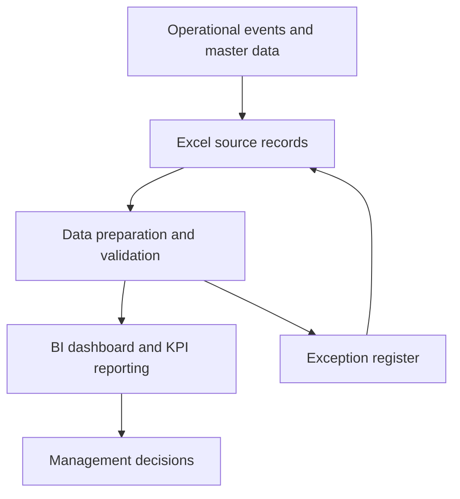

# Operational BI & Data Quality Audit

**Vörös Richárd | Business Process Analysis · Data Quality · BI · Process Improvement**

[Magyar összefoglaló](docs/hu.md) · [System design](docs/system-design.en.md) · [Validation approach](docs/validation.en.md)

## Business challenge
An operational beekeeping system uses an Excel workbook and a browser-based BI dashboard to support planning and daily decisions. Reliable reporting requires consistent master data, traceable operational events and correct aggregation of work time. The audit examines these relationships rather than treating visual presentation as proof of data quality.

## Approach
- Map operational processes, data inputs and decision outputs.
- Separate current master-data status from historical events.
- Reconcile identifiers, missing durations and overlapping work blocks.
- Validate KPI inclusion rules and document unresolved exceptions.

## Findings and corrective actions
The internal audit log documents missing work durations, duplicate time accounting across detail and summary rows, and inconsistent entity assignments. Corrections include deriving duration only from recorded start/end times, counting a parent work block once, and preserving historical records when the correct assignment is uncertain.

This is a scoped portfolio summary, not an assertion that every component of the production system is error-free. Final audit totals are withheld pending verification against the final report.

## System overview

Conceptual system flow, not a screenshot of the production dashboard.

## Synthetic sample data

[Open the complete CSV sample](sample-data/worklog.csv)

| Record | Block | Type | Status | Start | End | Minutes |
|---|---|---|---|---|---|---:|
| 1 | A | Summary | Actual | 08:00 | 08:40 | 40 |
| 2 | A | Detail | Actual | 08:00 | 08:15 | 15 |
| 3 | A | Detail | Actual | 08:15 | 08:40 | 25 |
| 4 | B | Standalone | Actual | 09:00 | 09:20 | — |
| 5 | C | Standalone | Actual | — | — | — |
| 6 | D | Standalone | Planned | 10:00 | 10:30 | 30 |

Expected result: 60 actual minutes (40 + 20), with one unresolved duration. Detail rows are not counted twice; planned work is excluded. These are synthetic demonstration records, not operational data.

## Demonstration scope
The synthetic CSV illustrates the audit rules; it is not production data or a standalone application.

## Technology
Excel, browser-based HTML/JavaScript reporting, data reconciliation and business rule validation.

## Publication scope
No production workbook, private operational records, exact locations or employer data are included. Internal documents and production dashboard source remain private.
