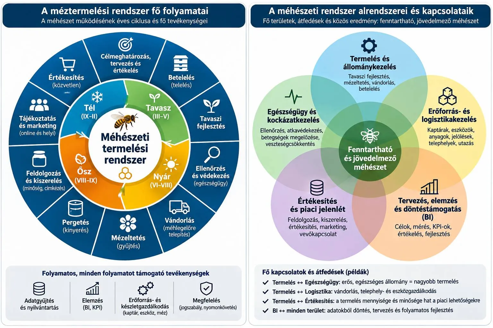
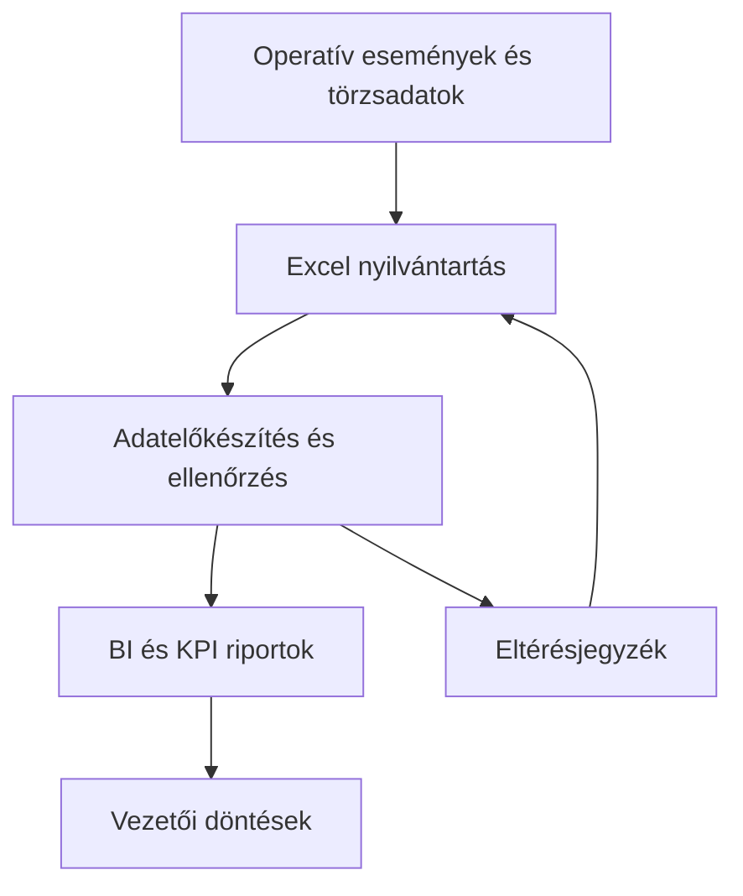

# Operatív BI-rendszer és adatminőségi audit

**Folyamatelemzés · Rendszerszervezés · Adatminőség · BI · Folyamatfejlesztés**

[English version](README.en.md) · [Rendszerterv](docs/system-design.md) · [Magyar dokumentáció](docs/hu.md)

## Üzleti probléma
Egy Excel-alapú méhészeti nyilvántartás és böngészőben futó BI-rendszer megbízhatóságának vizsgálata. A cél, hogy az operatív eseményekből ellenőrizhető mutatók és döntési információk készüljenek.

## Rendszertervi ábrák

**Bal oldalon:** éves működési ciklus és támogató folyamatok.

**Jobb oldalon:** funkcionális alrendszerek, kapcsolataik és a BI szerepe.

## A rendszer működése

A fogalmi ábra az információ útját mutatja, nem a tényleges dashboard képernyőképe.

## A lezárt audit eredményei (2026. november 15.)

| Vizsgálati eredmény | Érték |
|---|---:|
| Vizsgált naplósorok | 653 |
| Megőrzött munkalapok | 9/9 |
| Változatlan eredeti képletek | 35 |
| Dokumentált nyitott eltérések | 6 |

**Minősítés:** audit lezárva; a rendszer feltételesen validált. A vizsgált alap-KPI-k egyeztek a független számítással. A teljes böngészős Excel-betöltés és a diagramrajzolás még elfogadási tesztet igényel.

[Részletes auditösszefoglaló](docs/audit-results.md) · [Folyamat–adat–KPI mátrix](docs/process-data-kpi-matrix.md) · [Ellenőrzési módszertan](docs/validation.md)

## Audit és megállapítások
- Hiányzó időtartamok: csak igazolható kezdés és befejezés alapján történő pótlás.
- Kettős időelszámolás: összesítő munkablokkok és részletek elkülönítése.
- Ellentmondó azonosítók: forrásadatok megőrzése, bizonytalanság jelölése.
- Tényadatok és tervek elkülönítése, KPI-számítási szabályok ellenőrzése.

A vizsgálat nem igazolja a teljes rendszer hibamentességét. A fenti eredmények a lezárt V3 jegyzőkönyv szerinti vizsgálati hatókörre vonatkoznak.

## Mintaadatok és validáció

[CSV mintaadatok](sample-data/worklog.csv)

| Sor | Blokk | Típus | Státusz | Kezdés | Befejezés | Perc |
|---|---|---|---|---|---|---:|
| 1 | A | Összesítő | Tény | 08:00 | 08:40 | 40 |
| 2 | A | Részlet | Tény | 08:00 | 08:15 | 15 |
| 3 | A | Részlet | Tény | 08:15 | 08:40 | 25 |
| 4 | B | Önálló | Tény | 09:00 | 09:20 | — |
| 5 | C | Önálló | Tény | — | — | — |
| 6 | D | Önálló | Terv | 10:00 | 10:30 | 30 |

Elvárt eredmény: 60 perc tényleges munkaidő és egy tisztázatlan időtartam. A részletek nem számítanak kétszer, a tervezett esemény kimarad. A példa mesterséges adatokat használ.

A példa az Excel-alapú ellenőrzési logikát szemlélteti, nem önálló alkalmazás.

## Szakmai kompetenciák
Folyamatfeltárás, rendszermodellezés, üzleti szabályok, adatminőség, BI-validáció, döntéstámogatás. Technológia: Excel, HTML/JavaScript.

A csomag nem tartalmaz eredeti üzemi adatállományt vagy munkáltatói adatokat.

## English summary
A portfolio case study of operational BI and data quality auditing, covering process mapping, business rules, work-time reconciliation and exception handling. [Full English version](README.en.md).
