# BI-irányítópult – képernyőképes szakmai bemutató

**TESZTADATOK / TEST DATA.** Az audit tesztállományának képernyőképei, anonimizált telephelynevekkel. Nem aktuális üzemi mutatók; a tesztadatok nem szükségszerűen teljesen szintetikusak.

### Munkaidő KPI-k

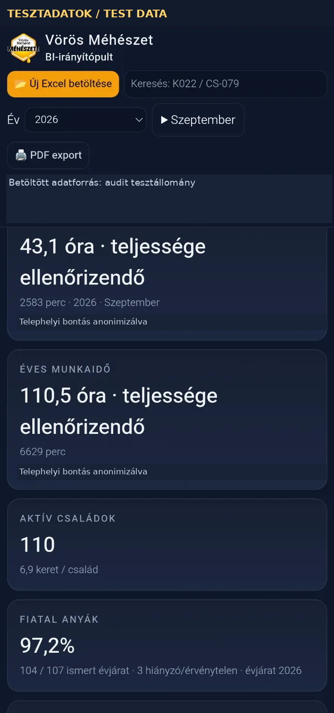

### Hatékonysági KPI-k

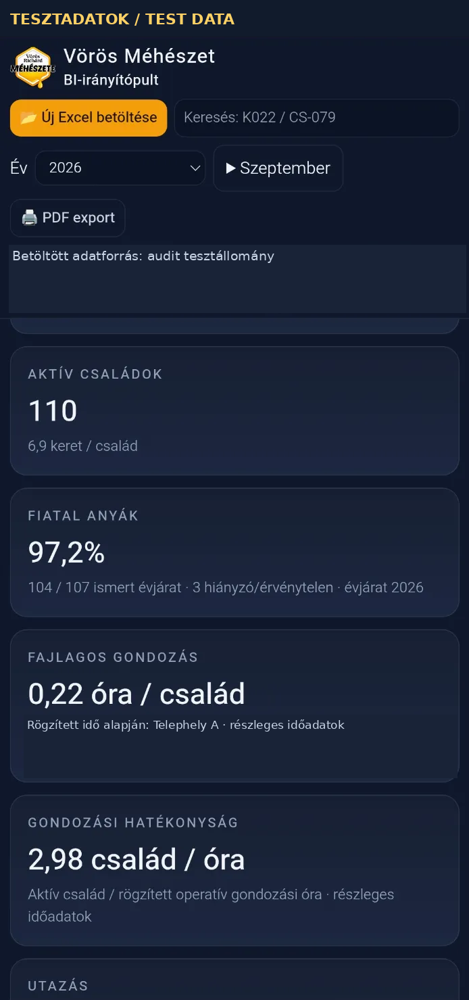

### Fajlagos gondozás

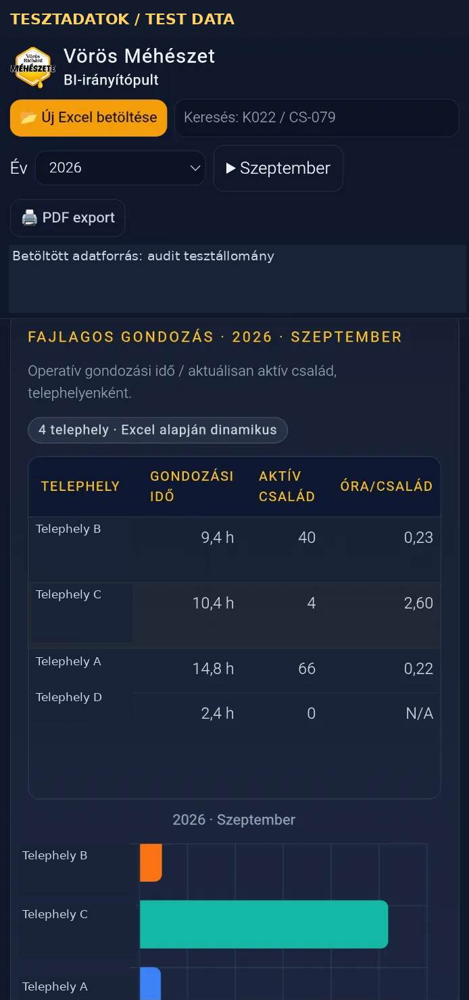

### Kockázati jelzések

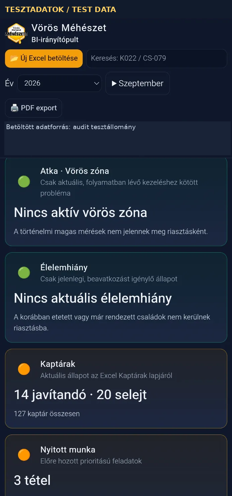

### Idősoros trend

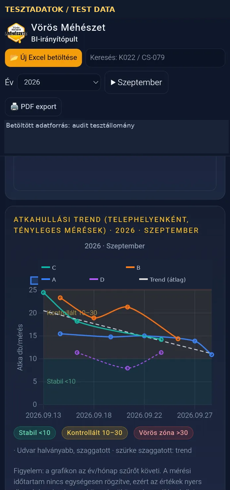

### Mérési lefedettség

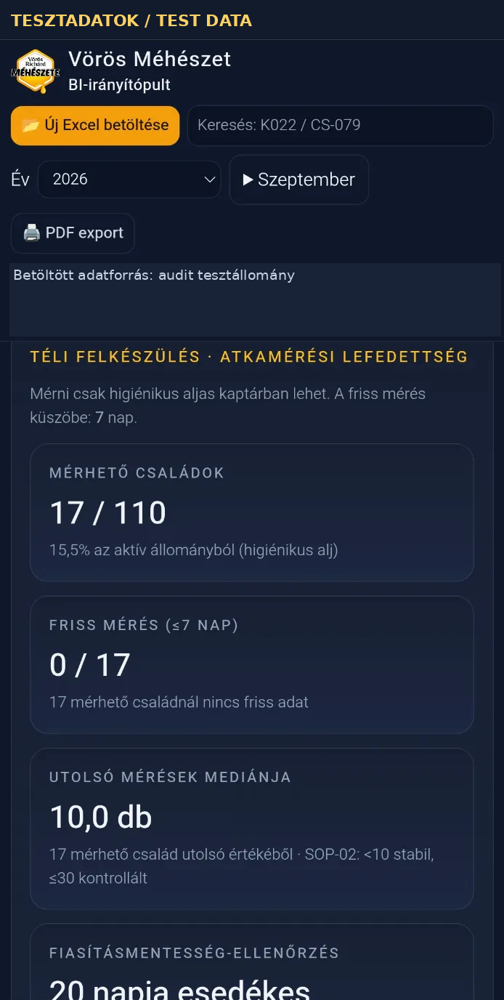

### Munkaidő megoszlása

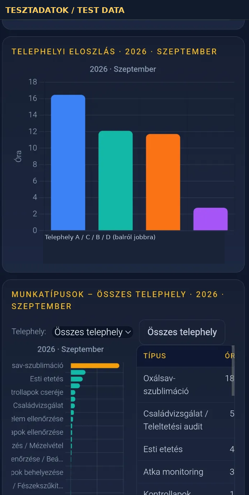

### Eszköz- és családállapot

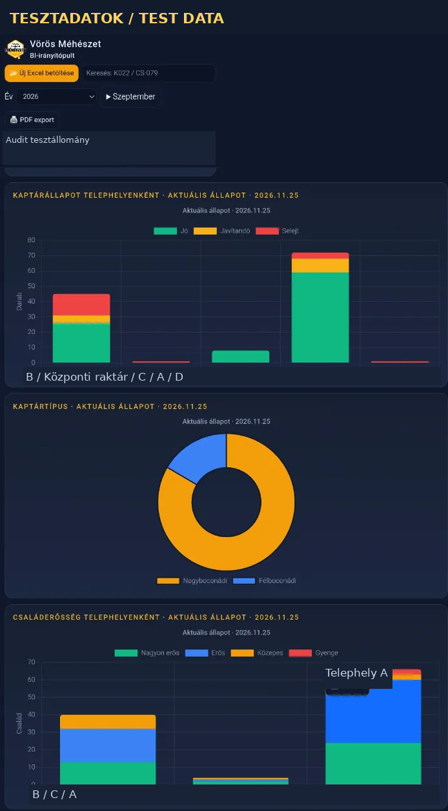

### Utazási mutatók

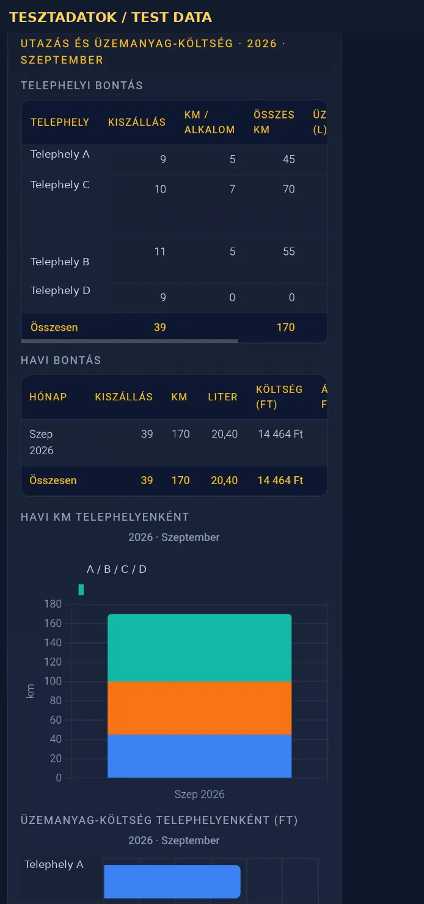

### Üzemanyagköltség

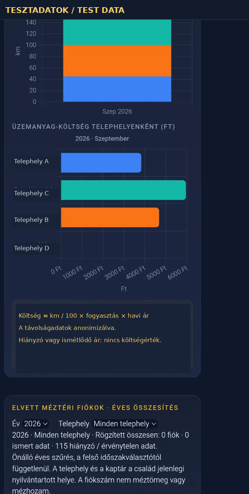

## Részletes családadatlap – lefúrás

### Családadatlap – törzsadatok

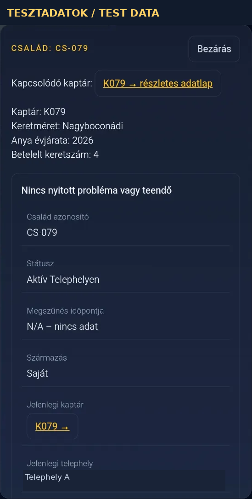

### Családadatlap – állapot

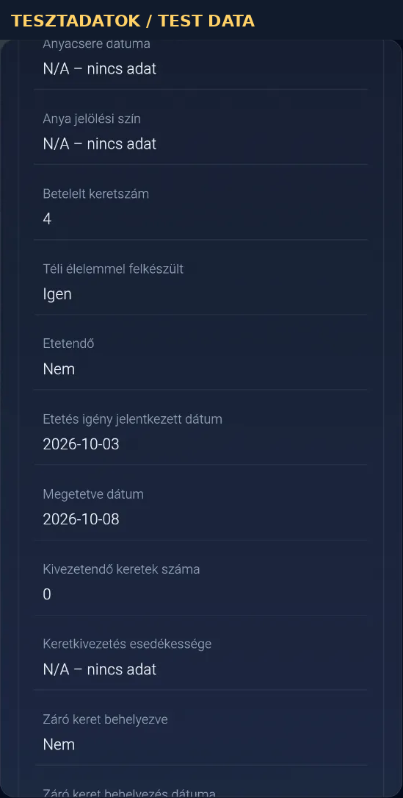

### Családadatlap – megjegyzések

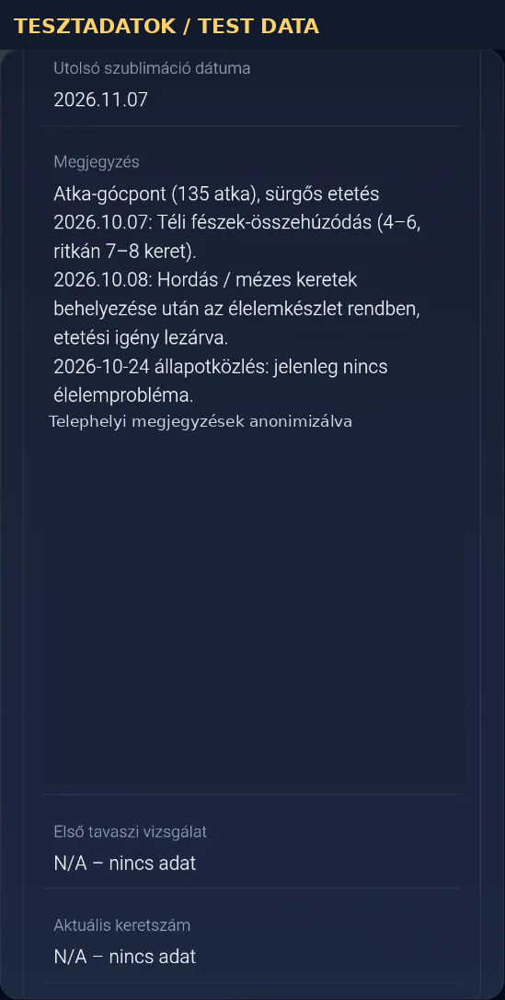

### Családadatlap – napló

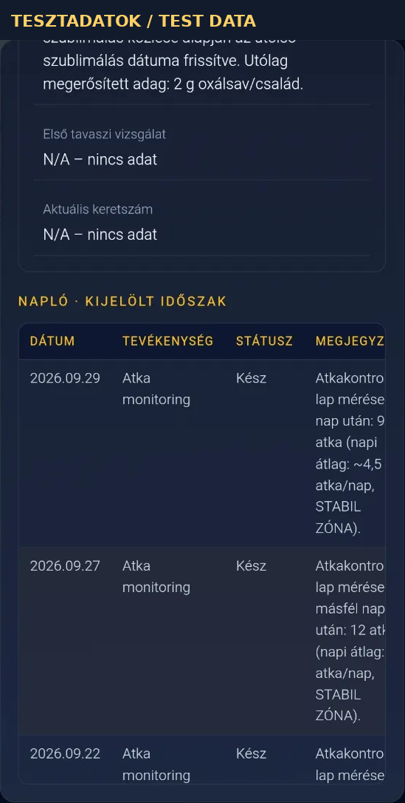

## Értelmezési korlátok

A képernyőképek a funkciókat szemléltetik, nem igazolják önmagukban a teljes rendszer hibamentességét. Lásd az [audit eredményeit](audit-results.md).
