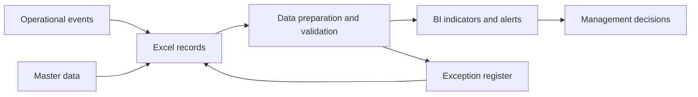

# Conceptual system design

This is a conceptual information flow, not a verified deployment diagram.

| Functional domain | Main purpose | Decision output |
|---|---|---|
| Production | Seasonal activities and colony management | Operational priorities |
| Health and risk | Monitoring and interventions | Follow-up inspections |
| Resources and logistics | Equipment, locations and work organisation | Resource allocation |
| Sales | Processing, packaging and market presence | Sales planning |
| Planning and BI | Targets, data checks and KPI evaluation | Management decisions |

## Business rules
- Historical events must not be silently overwritten with current master-data values.
- Planned activities must be distinguished from actual completed events.
- A work-block total must not be added to its own component rows.
- Unknown values must remain distinguishable from zero.
