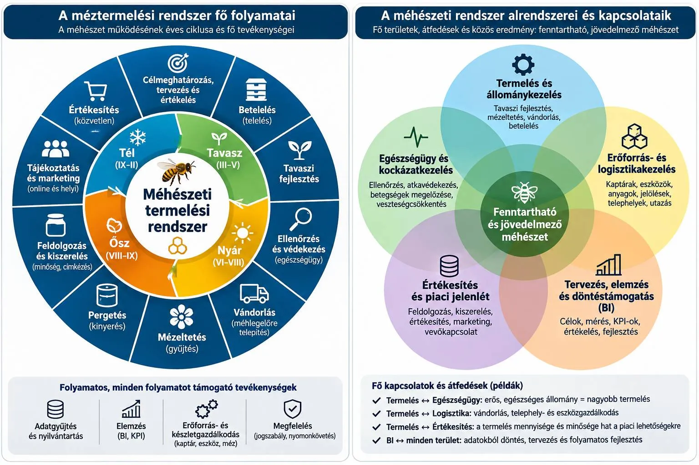
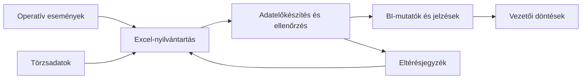

# Fogalmi rendszerterv

[English version](system-design.en.md)

## A működés folyamatai és alrendszerei

## Információáramlás

Ez fogalmi információáramlási ábra, nem ellenőrzött fizikai megvalósulási dokumentáció.

| Funkcionális terület | Fő feladat | Döntési információ |
|---|---|---|
| Termelés | Szezonális munkák és méhcsaládok kezelése | Operatív prioritások |
| Méhegészségügy és kockázat | Megfigyelés és beavatkozások | Utóellenőrzések |
| Erőforrások és logisztika | Eszközök, telephelyek és munkaszervezés | Erőforrás-elosztás |
| Értékesítés | Feldolgozás, kiszerelés és piaci jelenlét | Értékesítési tervezés |
| Tervezés és BI | Célok, adatellenőrzés és KPI-értékelés | Vezetői döntések |

## Üzleti szabályok
- A történeti eseményeket nem szabad a jelenlegi törzsadatokkal észrevétlenül felülírni.
- A tervezett és ténylegesen elvégzett munkákat külön kell kezelni.
- Egy munkablokk összesítő idejét nem szabad a saját részletsoraihoz hozzáadni.
- Az ismeretlen érték nem azonos a nullával.

A dokumentum a teljes belső rendszerterv rövid, portfóliócélú kivonata.
